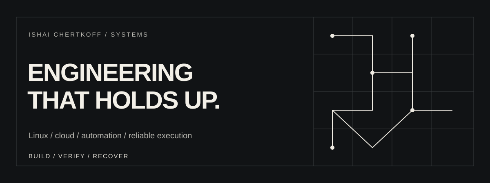

### ISHAI CHERTKOFF
**Infrastructure & Automation Engineering · Linux · Python · Cloud · Backend Systems**

Building systems that are **observable, recoverable and verifiable**.

[**Engineering work**](#selected-engineering-work) &nbsp;·&nbsp; [**Other projects**](#additional-projects-and-research) &nbsp;·&nbsp; [**Technical toolkit**](#technical-toolkit) &nbsp;·&nbsp; [**LinkedIn**](https://www.linkedin.com/in/ishai-chertkoff-b252183b3/)

---

I am an independent software builder focused on Linux application operations, backend integrations, cloud infrastructure and approval-gated automation. I care about what happens **after** software runs: retries, failure states, auditability and proof of outcomes.

**Seeking early-career opportunities in** Infrastructure Engineering, Systems Integration, Cloud Operations and Backend Automation — with room for hands-on debugging and technical mentorship.

## Selected engineering work

| Project | Engineering problem | Stack | Evidence |
|:--|:--|:--|:--|
| **[RACAI Operator](./case-studies/racai-operator.md)** | Durable work state, approvals and traceability across interfaces | TypeScript · Cloudflare Workers · D1 | [Design & implementation notes](./case-studies/racai-operator.md) |
| **[Control-Room](./case-studies/control-room.md)** | Bounded execution, tenant boundaries and duplicate-action protection | Node.js · PostgreSQL · Redis | [Architecture & concurrency decision](./case-studies/control-room.md) |
| **[ISHAI OS](./case-studies/ishai-os.md)** | Verify external actions against actual sources instead of trusting agent claims | Python · SQLite · GitHub API | [Controlled verification case](./case-studies/ishai-os.md) |

<strong>Explore the engineering decisions behind these projects</strong>

### [RACAI Operator — durable work and authorization](./case-studies/racai-operator.md)
**TypeScript · Cloudflare Workers · D1 · Telegram / web interfaces**

**Challenge:** Work initiated through chat needs persistent state, explicit approval and an audit trail rather than an unverified “done” message.

**Engineering approach:** Structured task and proposal records, owner approval/rejection boundaries, scheduled execution and operational evidence. Tests, merge status and live deployment are treated as separate claims.

**Status:** Internal platform; code and operational state remain private. The linked case study documents design, not independently verified uptime or commercial adoption.

### [Control-Room — controlled agent execution](./case-studies/control-room.md)
**Node.js · Express · PostgreSQL · Redis**

**Challenge:** Multi-tenant workflows require scoped data, bounded tool access and protection against concurrent duplicate action attempts.

**Engineering decision:** Separate an agent's proposal from an allowlisted executor. A PostgreSQL transaction with `SELECT ... FOR UPDATE` claims approved work before adapter invocation.

**Status:** Historical implementation. This does not claim provider-level exactly-once delivery.

### [ISHAI OS — source-backed read-only verification](./case-studies/ishai-os.md)
**Python · SQLite · GitHub API**

**Challenge:** An agent's assertion that an external task is complete is not evidence that it happened.

**Controlled demonstration:** Inspect a current GitHub pull request, validate digests of historical CI artifacts and store timestamped, source-attributed results without generating an unauthorized write proposal.

**Status:** Bounded demonstration, not general autonomy or a continuously deployed service.

## Runnable engineering demonstration

**[Reliable Execution — Python / SQLite](./demos/reliable-execution/README.md)** is a small, public, dependency-free state-machine example with 11 unit tests covering concurrent claims, invalid transitions, persistence and uncertain outcomes. It is intentionally separate from the historical RACAI systems; the local receipt is not independently authenticated.

[Read the code](./demos/reliable-execution/reliable.py) · [Review the tests](./demos/reliable-execution/tests/test_reliable.py) · [Run instructions](./demos/reliable-execution/README.md)

## Additional projects and research

The selected projects above are the most relevant evidence for infrastructure and systems engineering roles. My wider work also includes:

- **B-Sure — applied AI credit-review prototype:** Node.js and server-sent events; a staged document, financial-analysis, research, scoring and follow-up workflow with human review. Proof of concept, not a deployed lending product.
- **NYRA — generative media production tooling:** Python workflows for versioned creative assets, preflight checks, cost controls and iteration informed by recorded failures.
- **RAC-stack — local agent runtime and control surface:** Python-based local operations and recovery experiments. Development work; private source, with no claim of production-grade availability.
- **Jarvis — earlier agent coordination experiments:** historical exploratory work, not an active commercial offering.
- **Theta–Erdős — mathematical research experiments:** symbolic and numerical exploration with explicit verification and uncertainty boundaries.

These projects are intentionally included for breadth, while the three case studies above provide the clearest technical depth. Source access and implementation maturity vary by project.

## Engineering principles

> A proposed action is not an executed action. A passing test is not a deployed service. A completed task needs evidence.

## How I work

- Investigate failure states, retries and duplicate requests before claiming success.
- Keep durable state, authorization and audit evidence outside the model conversation.
- Use GitHub pull requests, CI and source-linked checks to distinguish implemented, tested and deployed work.
- Document limitations clearly; private repositories are not presented as publicly reproducible code.

## Technical toolkit

**Infrastructure:** Linux / Ubuntu · AWS EC2 / S3 / IAM · Cloudflare Workers / D1 / R2 · Docker · PM2  
**Software:** Python · TypeScript · JavaScript · Node.js · Express · REST APIs · webhooks  
**Data & delivery:** PostgreSQL · Redis · Git · GitHub Actions · CI/CD · task queues

## Availability and contact

Based in Portugal with EU work authorization; open to relevant opportunities in Israel. For hiring conversations, connect through [LinkedIn](https://www.linkedin.com/in/ishai-chertkoff-b252183b3/).

## Links

[GitHub](https://github.com/Ishaipita) · [LinkedIn](https://www.linkedin.com/in/ishai-chertkoff-b252183b3/) · [RACAI](https://rac-ai.com/) · [RACAI Operator case study](./case-studies/racai-operator.md) · [Control-Room case study](./case-studies/control-room.md) · [ISHAI OS case study](./case-studies/ishai-os.md)
