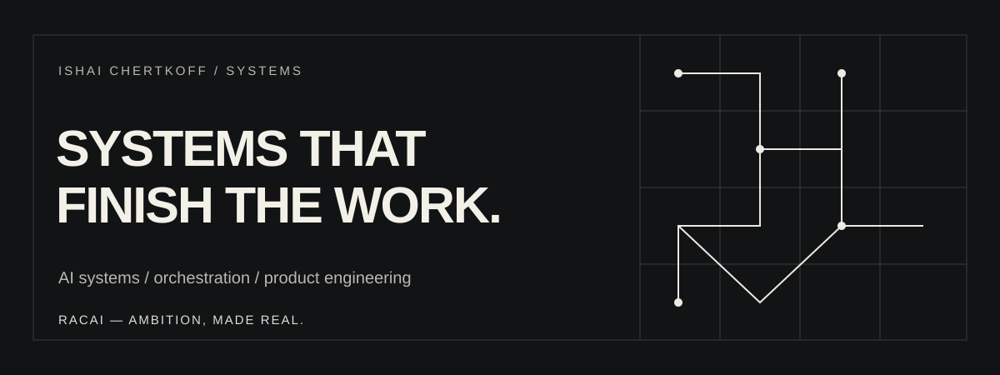

### ISHAI CHERTKOFF
**Independent software builder · AI systems & product engineering**

[Selected work](#selected-work) &nbsp;·&nbsp; [RACAI](https://rac-ai.com/)

---

I build software at the intersection of AI, backend systems and products. Much of my work has focused on a practical question: **what does it take for software to carry work through to a result that can be checked?**

I have developed systems for agent coordination, persistent state, permissions, external tools and operational review. RACAI is my continuing work in this area.

## Selected work

### [RACAI Operator](./case-studies/racai-operator.md)
**Internal operating software · TypeScript, Cloudflare Workers, D1**

Work intake, persistent state, approval flows, audit records and scheduled operations. The work combines application engineering, release discipline and operational design.

[Architecture and implementation notes →](./case-studies/racai-operator.md)

### [Control-Room](./case-studies/control-room.md)
**Agent execution and governance · Node.js, PostgreSQL, Redis**

A multi-tenant engineering project with a bounded plan–act–verify process, scoped memory and a separate approval-gated executor for external actions.

[Engineering case study →](./case-studies/control-room.md)

### B-Sure
**Applied AI prototype · Node.js, SSE**

A five-stage workflow for reviewing SME credit applications: document extraction, financial analysis, external research, scoring and follow-up questions. Built as a proof of concept with explainable outputs and human review.

### NYRA
**Generative media tooling · Python**

A reference-based production workflow with versioned assets, spending controls and reproducible preflight checks. Iterations were informed by recorded generation failures and image-consistency tests.

Earlier work and research

**Jarvis** — experiments in multi-agent coordination and financial research tooling.

**Theta–Erdős** — symbolic and numerical exploration using independent verification and explicit confidence classifications.

## Engineering approach

My approach combines practical product development with disciplined systems engineering: clear state transitions, explicit authorization, testable execution paths and evidence-based review.

The case studies document selected architectural decisions and implementation approaches. Internal source repositories remain private.

## Technologies

TypeScript · JavaScript · Python · Node.js · Cloudflare Workers · D1 · PostgreSQL · Redis · AWS · GitHub Actions · REST APIs

---

[RACAI](https://rac-ai.com/) &nbsp;·&nbsp; [Control-Room case study](./case-studies/control-room.md) &nbsp;·&nbsp; [GitHub profile](https://github.com/Ishaipita)

