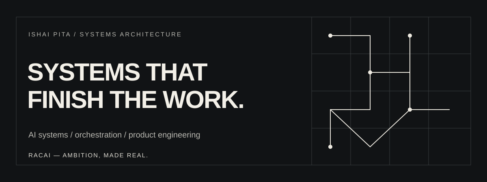

<div align="center">



### FOUNDER / SYSTEMS ARCHITECT / PRODUCT BUILDER

**Building RACAI — an evolving company for intelligent systems, creative technology and dependable execution.**

[**Explore RACAI ↗**](https://rac-ai.com/) &nbsp; · &nbsp; [**Engineering repositories ↗**](https://github.com/Ishaipita?tab=repositories)

</div>

---

## 01 / THE THESIS

> **Generating an answer is easy. Carrying responsibility from an objective to a verified outcome is the hard part.**

I work across software, AI, infrastructure, operations and creative production. What connects the work is a commitment to systems that stay useful **after the first demo**: measurable, maintainable, appropriately governed and designed around real people.

**RACAI is the long-term umbrella for turning this accumulated work into dependable, commercially useful products and services.** Different projects have different owners, histories and maturity levels. Not every experiment is currently a RACAI product.

## 02 / A BODY OF WORK

| Practice | Selected work | What it demonstrates |
|:--|:--|:--|
| **Operating systems** | RACAI Operator / Control-Room | Agent orchestration, scoped memory, queues, approval gates, audit trails and execution evidence |
| **Cloud & infrastructure** | AWS-era systems → Cloudflare Workers + D1 | Cloud operations, migrations, policy boundaries and resilient event-driven architecture |
| **Applied AI** | B-Sure | Five-stage credit-analysis research prototype with explainable outputs and human review |
| **Creative systems** | NYRA / AI production tooling | Canonical visual identity workflows, editorial automation, asset provenance and spending controls |
| **Autonomous experimentation** | Jarvis | Historical specialist-agent coordination, scheduling, queues and research tooling; financial automation is not offered as a live service |
| **Mathematical exploration** | Theta–Erdős research | Symbolic derivation, numerical checking and explicit levels of evidence |

<sub>Projects above represent different development stages. A prototype is not a production deployment, and an internal tool is not evidence of a paying customer. Commercial availability and ownership are not implied by inclusion.</sub>

## 03 / ENGINEERING PRINCIPLES

**01 — Reuse before rebuild.** Start with the real code, prior decisions, tests and operational history.

**02 — Separate authority from capability.** An AI agent proposing a change does not authorize that change.

**03 — Measure what happened.** A commit is not a deployment; a deployment is not customer acceptance; a test checkout is not revenue.

**04 — Design for recovery.** Durable state, reproducible releases, auditable action and clear rollback.

**05 — Make the product worth returning to.** Less coordination burden, better decisions and verifiable outcomes.

## 04 / HOW THE SYSTEMS FIT

```text
OWNER / TEAM GOAL
       │
       ▼
 CONTEXT + PRIORITIES
       │
       ▼
 RESPONSIBILITY + APPROVAL
       │
       ▼
 CONNECTED WORKFLOWS
       │
       ▼
 PROVIDER EVIDENCE
       │
       ▼
 VERIFIED OUTCOME ───► LEARNING / NEXT ACTION
```

This is the architectural direction, not a claim that every connection in the diagram is live.

## 05 / TOOLS & DOMAINS

`Python` · `TypeScript` · `Node.js` · `PostgreSQL` · `Redis` · `Cloudflare Workers` · `D1` · `AWS` · `GitHub Actions` · `Telegram` · `AI orchestration` · `Product engineering`

---

<div align="center">

### MAKE AMBITION OPERABLE.

**RACAI — Ambition, made real.**

[Company ↗](https://rac-ai.com/) &nbsp; · &nbsp; [Source and projects ↗](https://github.com/Ishaipita?tab=repositories)

</div>
